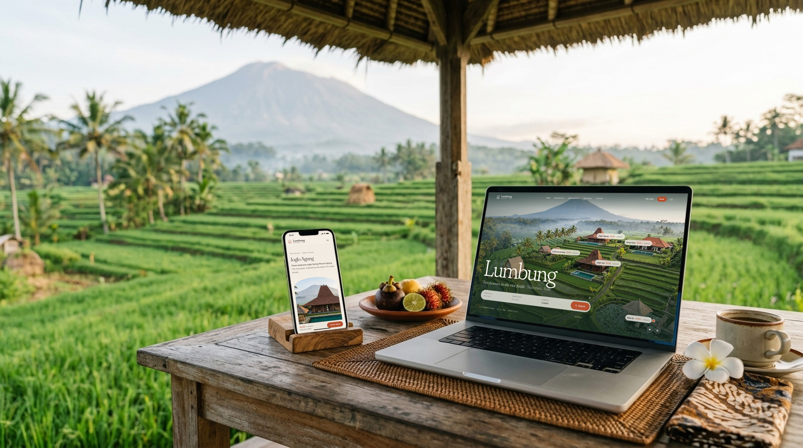
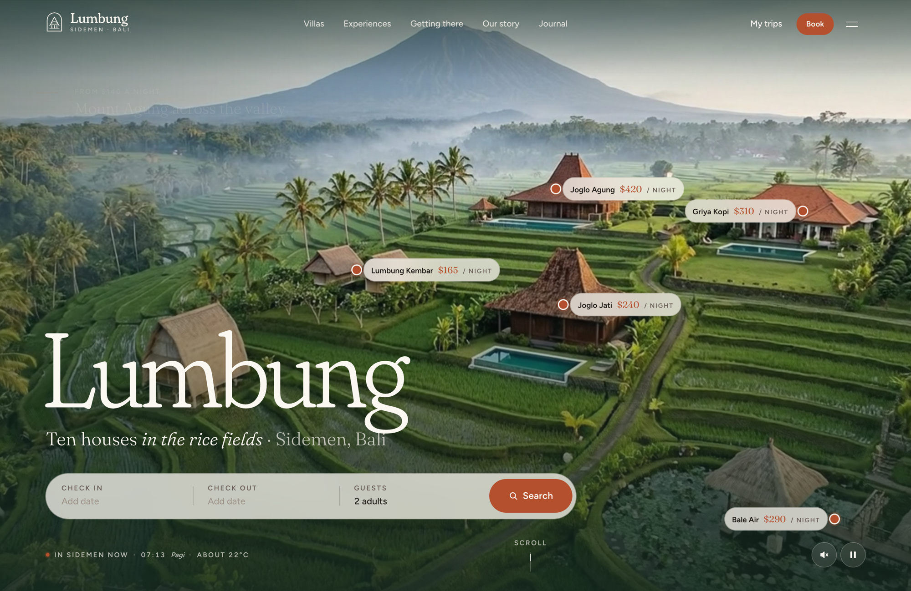
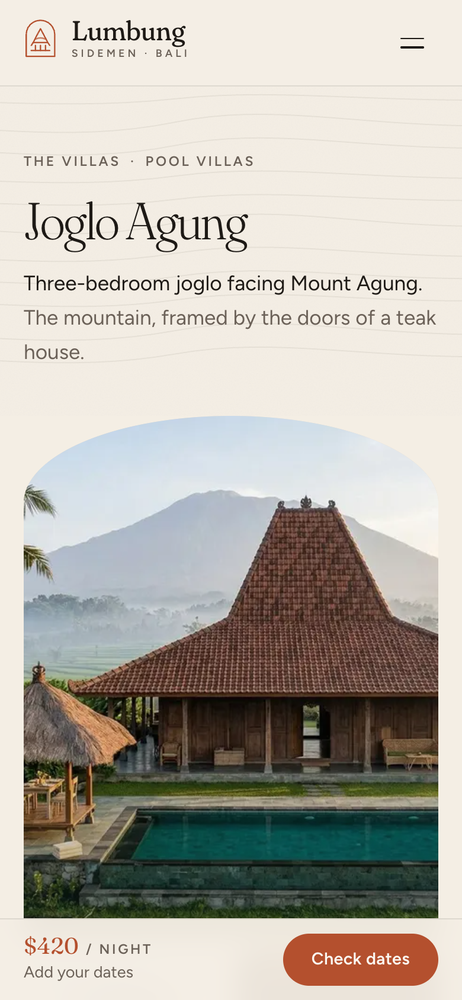
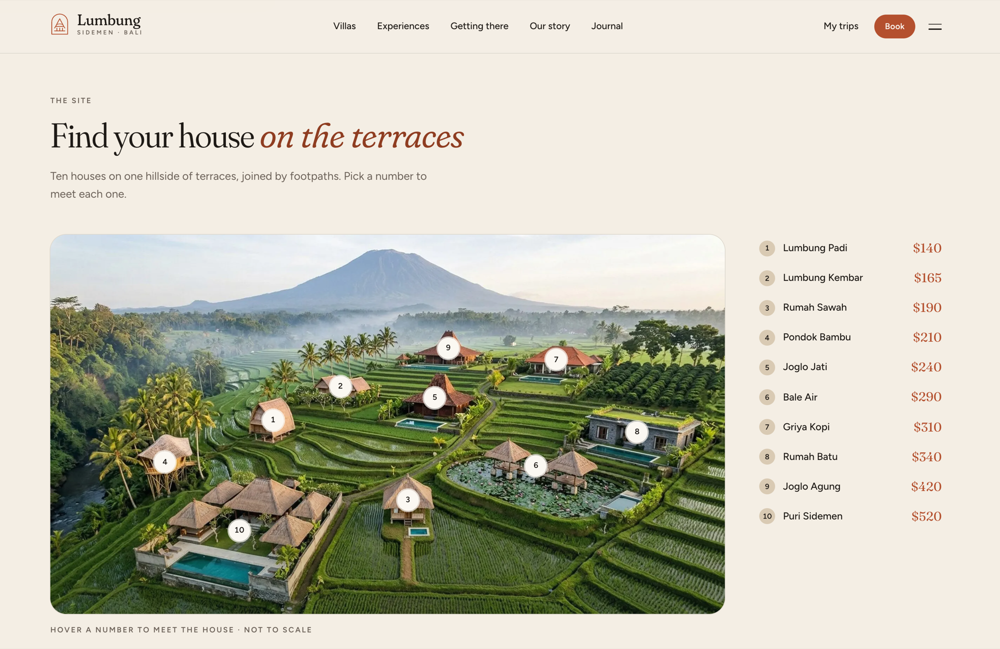
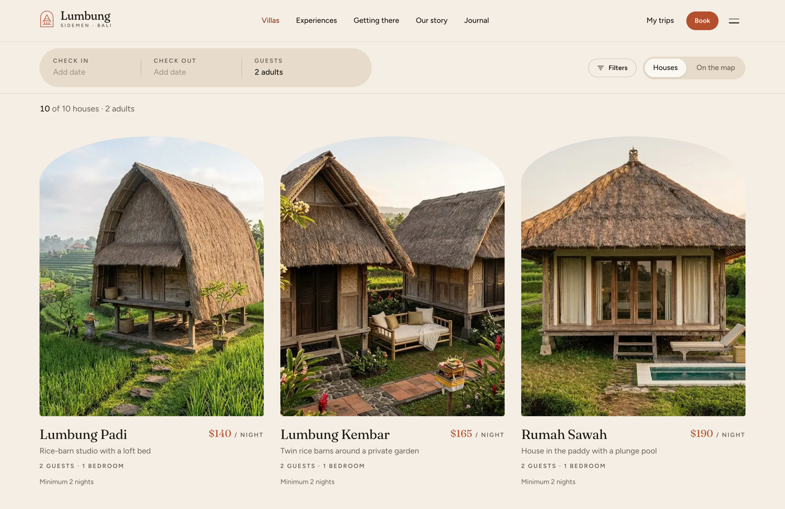
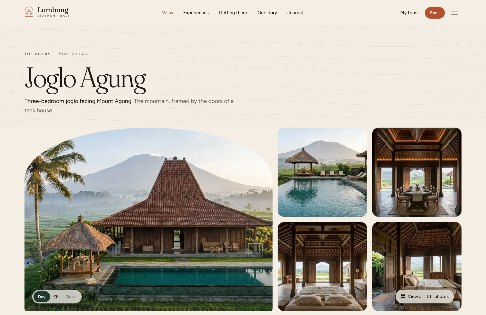
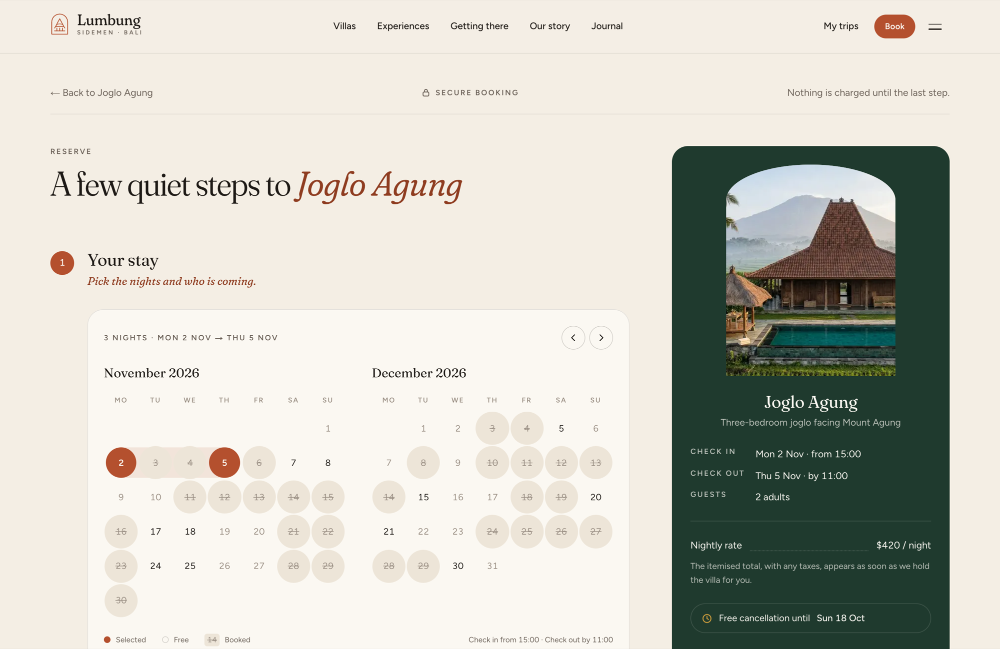
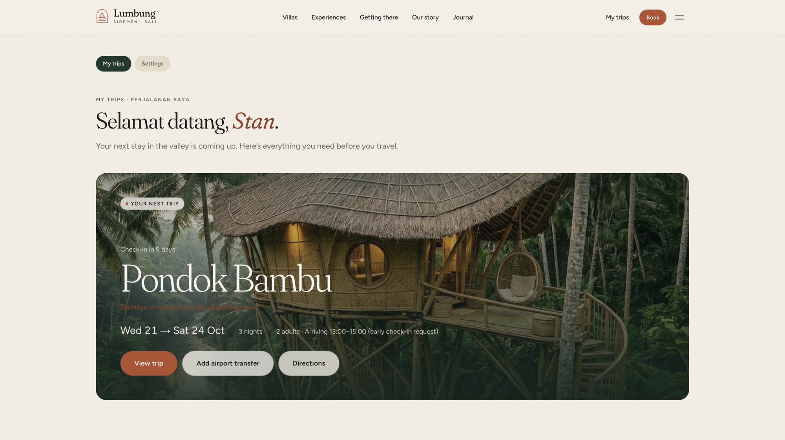
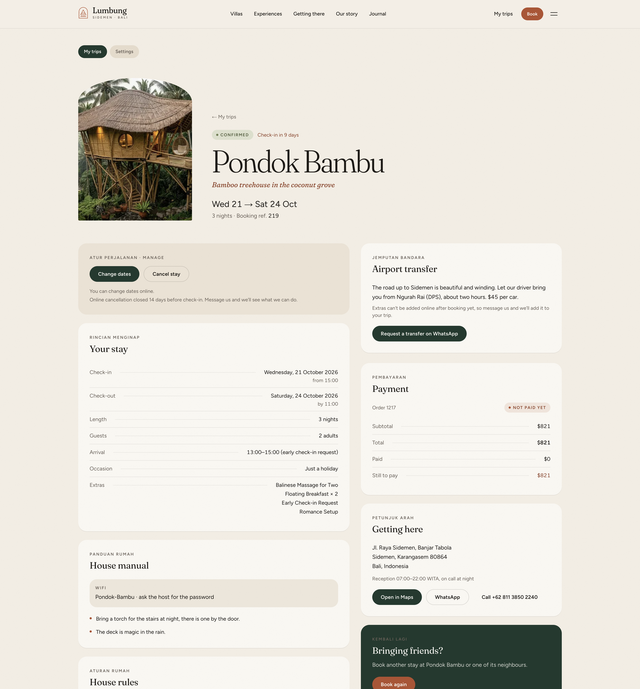

# Lumbung Sidemen — Next.js Bali Villa Rental Template

A production-ready booking website for a villa resort or holiday-rental business. Built with **Next.js 15**, **Tailwind CSS v4**, and the **Opencals Storefront SDK**.

**[View Live Demo →](https://template-bali-villas.vercel.app)**



Warm, quiet and hand-made: limestone paper and jungle-green surfaces, one terracotta accent, a soft Fraunces display face and Balinese motifs (the candi bentar split gate, rice-terrace contour lines, ikat rules, a canang sari loader). Set in **Sidemen, East Bali** (USD, `Asia/Makassar`) with ten villas stepped down the terraces, from a rice-barn studio to a four-bedroom estate, booked **by the night** with a fixed **check-in at 15:00 and check-out at 11:00**. Full storefront included — drone-flyover home page, villa list, room-by-room villa pages, a custom stay checkout with extras, and passwordless trip accounts — wired up out of the box. MIT licensed: clone it, rebrand it, ship it.

---

## Get Started in 3 Steps

### 1. Create an Opencals account

Sign up at **[app.opencals.com](https://app.opencals.com)** and create a **Dev Store**. When prompted for a dataset, choose the **Bali Villa Rentals** preset (category **Villa resort**, seed dataset `villa_resort`). It seeds your store with the ten villas on a continuous 24/7 schedule with fixed check-in and check-out, the four collections (Rice barns, Pool villas, Family houses, Signature), the stay extras (airport transfer, floating breakfast, massage, sunrise trek, cooking class, romance setup, early check-in and late check-out requests), the checkout questions and sample bookings, so your template looks exactly like the demo.

### 2. Get your API key

Go to your **User Account Settings** in the Opencals dashboard and generate a **Storefront API key**. You'll need this to connect the template to your store. If you restrict the key to allowed origins, include your deployed domain.

### 3. Deploy to Vercel

[](https://vercel.com/new/clone?repository-url=https%3A%2F%2Fgithub.com%2Fletsopencals%2Ftemplate-bali-villas&env=OPENCALS_API_KEY,AUTH_SECRET&envDescription=API%20key%20from%20your%20Opencals%20dashboard%20and%20a%20random%20secret%20for%20auth&project-name=lumbung-sidemen&repository-name=template-bali-villas)

During deployment, Vercel will ask you to set environment variables:

| Variable | Value |
|----------|-------|
| `OPENCALS_API_KEY` | Your Storefront API key (starts with `sfk_`) |
| `AUTH_SECRET` | Any random string — used for session encryption |
| `NEXT_PUBLIC_STRIPE_PUBLISHABLE_KEY` | *(optional)* Stripe publishable key for payments |

Then set `url` in `lib/site-config.ts` to your domain (it drives the sitemap, canonical URLs and Open Graph). That's it.

---

## The Storefront





---

## What's Included

### The Home Page

A candi bentar gate opens over a **drone flyover** of the valley. Each villa has a **price pin** that follows it through the video (desktop and mobile clips have their own tracked keyframes), with timed captions and a dates-and-guests search. Below it: the valley story, an arched villa carousel, an **illustrated site map** with all ten houses numbered on the terraces, an experiences mosaic, "A day at Lumbung" (Pagi, Siang, Sore, Malam), a price promise, testimonials, a journal teaser and the FAQ. With reduced motion the video freezes on a still with static pins.



### The Villas

- **`/villas`** — arched photo cards with the nightly price, guests, bedrooms and minimum stay, filters for guests, bedrooms, pool, price and collection, and a map view. With dates set, each villa checks its live availability and shows the total for your nights, or the next free stay.
- **`/villas/[slug]`** — the showpiece. A **Day ↔ Dusk** toggle on the hero, a gallery and lightbox grouped by room, a **room-by-room tour**, an SVG floor plan, sleeping arrangements, amenities, a locator on the site map, house rules, a cancellation timeline, reviews and similar villas. A sticky **reservation card** has a two-month calendar with booked nights struck through, the villa's minimum stay, a guest picker capped at the villa's maximum and a nightly × N breakdown. On mobile it becomes a bottom bar that opens a sheet. `VacationRental` + `Accommodation` structured data.





### The Stay Checkout

**`/reserve/[slug]?checkin=&checkout=&adults=&children=`** is a single-page checkout built for stays:

1. **Your stay** — change dates and guests inline, checked against the villa's availability.
2. **Make it yours** — extras as photo cards: per-night ones as toggles, transfers and classes with a count.
3. **Guest and arrival** — the lead guest, arrival time, flight number, the occasion and the store's checkout questions.
4. **Payment** — Stripe Elements (loaded on demand), a promo code and the policy consent, with cash and no-payment fallbacks.

A green summary rail shows *Fri 14 Nov 15:00 → Mon 17 Nov 11:00*, the nights, the line items and taxes exactly as the store charges them, the free-cancellation date and the hold timer (*We're holding Joglo Agung for 14:32*). The confirmation page says *Sampai jumpa di Sidemen* with the itinerary, an `.ics` download, getting-there steps and a pre-arrival checklist.



### My Trips

Passwordless sign-in: guests enter their email and receive a 6-digit login code, or follow a magic link. The account is built around trips: the next stay with a countdown, arrival details and quick actions, then upcoming and past trips. A trip page shows the dates, guests, arrival, extras and payments, the villa's **house manual** (wifi, house rules, tips) and directions. Guests can **change dates** (checked against the villa's availability) or **cancel** inside the cancellation window, book again, and leave a review after the stay.

One-time email links from Opencals (view/reschedule/cancel booking, leave feedback, verify email) all resolve through the `/link/[token]` route, which signs the guest in and redirects them to the right place.

> **Set your Storefront Base URL.** For emailed links to point back to this app, set **Storefront Base URL** in your Opencals dashboard (Settings → API) to your deployed URL (e.g. `https://your-domain.com`). Opencals builds every customer link as `{storefrontBaseUrl}/link/{token}`.





### Story Pages

**Experiences** (the Mount Agung sunrise, songket weaving, a cooking class, massage, the warung, temples and the village), **Getting there** (from Denpasar airport, transfers, the drive), **About** (the family and the valley), a **Journal** of three posts, the **FAQ** and **Contact**.

### Motion

Lenis smooth scrolling, the gate reveal and page curtain, line-mask text reveals, parallax, count-ups, a marquee and a scroll progress bar. Every effect has a `prefers-reduced-motion` fallback.

### SEO Ready

Per-page metadata, Open Graph cards, `LodgingBusiness`, `VacationRental` and `Accommodation` structured data, robots.txt, and sitemap.xml — configured out of the box.

---

## The Stay Model

Lumbung Sidemen uses existing Opencals features only. If you build your own villa, cabin or room-rental site, this is the pattern:

- **One villa = one product with no staff.** Base `duration: 86400` (one night is the pricing unit), `allowCustomDuration: true`, a `maxDuration` (21 nights in the seed) and `maxAttendees: 1`. Each villa sits in its own product pool, so a booking blocks only that villa. Each villa is its own product, not a variant, because variants don't block each other.
- **Fixed check-in and check-out.** `fixedTimes: true` with `fixedStartTime: '15:00:00'` and `fixedEndTime: '11:00:00'`. The server rejects customer bookings and reschedules at any other times with a `400`, in the schedule's timezone. Bookings the merchant makes in the dashboard are exempt, so an early check-in can still be arranged.
- **A continuous schedule.** Every villa is on a 24/7 schedule, so a stay runs across midnight and over many nights. Stays are validated against continuous availability on the server.
- **Nights, not hours.** N nights run from 15:00 on the check-in day to 11:00 on the check-out day. That's not a whole multiple of 24 hours, so the price rounds up to whole units: three nights cost 3 × the nightly rate. `lib/stay.ts` → `toStaySlot` converts local dates to the UTC slot: Bali 14 → 17 Nov becomes `{ fromDate: '2026-11-14', fromTime: '07:00:00', toDate: '2026-11-17', toTime: '03:00:00' }`. The slot is built on the server in `/api/reserve`, never in the browser.
- **Turnover days.** A night blocks only 15:00 → 11:00, so one guest's check-out day can be the next guest's check-in day.
- **Ranges, not slots.** The UI reads the villa's merged availability ranges (`/api/villas/[slug]/ranges`) and decides on the client which nights are free and whether a stay fits (`isNightAvailable`, `fitsStay`, `latestCheckout`, `firstFreeStay`). The server re-checks on booking.
- **Custom attributes for the guests.** Adults, children, infants, arrival time, flight number and occasion are **not** part of the slot. They travel as appointment `customAttributes` (keys in `siteConfig.customAttributeKeys`) and show up in the dashboard and the guest's trip.
- **Template-side rules.** The minimum stay and the maximum number of guests live in `lib/villa-content.ts`; the cancellation window comes from the product's `cancelGap` (14 days in the seed).
- **Per-night extras.** Add-ons with `durationMultiplied` are charged per booked unit, which is exactly per night.

---

## Tech Stack

| Category | Technology |
|----------|-----------|
| Framework | Next.js 15 (App Router) |
| Styling | Tailwind CSS v4 |
| Fonts | next/font: Fraunces (variable, `opsz`/`SOFT`/`WONK`), Figtree |
| Animations | Framer Motion + Lenis |
| Data | SWR (client) + React Server Components |
| Forms | react-hook-form + Zod |
| Payments | Stripe Elements |
| Auth | NextAuth.js v5 |
| Dates | moment-timezone |
| API | Opencals Storefront SDK (v0.3.17) |

---

## Local Development

```bash
git clone https://github.com/letsopencals/template-bali-villas.git
cd template-bali-villas
npm install
cp .env.example .env
```

Edit `.env` with your values:

```
OPENCALS_API_KEY=sfk_your_key_here
AUTH_SECRET=change_me_to_a_random_string
```

```bash
npm run dev
```

Open [http://localhost:3000](http://localhost:3000).

Checks: `npm run typecheck`, `npm run lint` and `npm test` (vitest, including the stay maths in `lib/stay.test.ts`).

---

## Customization

### Branding & Content

Business-specific copy is centralized in two files:

- **`lib/site-config.ts`** — name, tagline, site URL, currency and timezone, contact details, check-in and check-out times, the custom-attribute keys, arrival times and occasions, navigation, collection labels, and the hero pins and captions.
- **`lib/villa-content.ts`** — `villaContent[slug]` per villa: tagline, story, size, guests, beds and baths, minimum nights, rooms (with the photos for each), amenities, house rules, the floor plan, the site-map position and the house manual. Villas that aren't listed fall back to the API data.

The story pages read from `components/marketing/*-content.ts` and the journal from `content/journal/`. The bookable data (villas, prices, availability, extras, checkout questions) comes from your Opencals store.

### Theme Colors

Design tokens live in **`app/globals.css`** as Tailwind v4 `@theme` properties. The full design system (type scale, motifs, components, z-index map) is in **`DESIGN.md`**.

```css
@theme {
  --color-paper: #f4eee4;       /* limestone page */
  --color-sand: #e7dccb;        /* cards and panels */
  --color-jungle: #1f3a2e;      /* dark sections, footer, checkout summary */
  --color-terracotta: #b4502e;  /* the only accent */
}
```

Cards are rounded 24px, images 20px, and buttons and chips are pills.

### Imagery

Every image sits in an `.image-placeholder` container and renders through `SafeImage`, so a missing file falls back to a soft paper gradient instead of a broken box. **Villa photos, the storefront banner and the logo come from your Opencals store**: product images (the default one first, the rest named by room, e.g. `joglo-agung-pool`, so the gallery can group them). Change them in the dashboard, not in the code. Editorial art ships in `public/images/` (experiences, getting there, about, journal, the site-map illustration), and the hero flyover and ambient films in `public/videos/`. If you replace the hero video, re-track the pins with `scripts/image-generation/track_villa_resort_hero_pins.py` in the Opencals repo, or swap in static pins.

---

## Project Structure

```
app/
  page.tsx                     # Home: gate, flyover hero, site map, experiences
  villas/                      # Villa list + villa pages
  reserve/[slug]/              # Stay checkout
  reserve/confirmed/[id]/      # Confirmation and itinerary
  experiences/ getting-there/ about/ journal/ faq/ contact/
  account/                     # My trips, trip pages, settings
  auth/                        # Sign in by code
  link/[token]/                # One-time email link resolver
  api/                         # API routes proxy SDK calls server-side

components/
  home/                        # Hero flyover, site map, carousel, day timeline
  villas/ villa/               # Villa cards, filters, map; villa page sections and booking card
  reserve/                     # Checkout sections, summary rail, Stripe
  account/                     # Trips, trip detail, settings
  marketing/                   # Story pages
  motifs/                      # Candi bentar, terrace lines, ikat rule, canang sari
  motion/ layout/ stay/ ui/    # Motion, header/footer, date and guest pickers, primitives

hooks/                         # use-villa-ranges, use-stay-booking, use-booking-add-ons, ...
lib/                           # site-config, villa-content, stay (night + slot maths), server-data, opencals, auth, seo
```

## Environment Variables

| Variable | Required | Description |
|----------|----------|-------------|
| `OPENCALS_API_KEY` | Yes | Storefront API key from your Opencals dashboard |
| `AUTH_SECRET` | Yes | Random string for NextAuth session encryption |
| `NEXT_PUBLIC_STRIPE_PUBLISHABLE_KEY` | No | Stripe publishable key for payment processing |
| `OPENCALS_API_URL` | No | Override API base URL (defaults to production) |

The public site URL is `url` in `lib/site-config.ts`.

---

## Other Templates

Lumbung Sidemen is one of the open-source booking templates built on the Opencals Storefront SDK. Same backend, different design and vertical:

- **[Clear Care](https://github.com/letsopencals/template-clarity)** — a medical clinic template with department-first booking. [Live demo](https://template-clarity.vercel.app)
- **[Frisor](https://github.com/letsopencals/template-frisor)** — a modern barbershop template with a dark editorial palette. [Live demo](https://template-frisor-sage.vercel.app)
- **[HAAR](https://github.com/letsopencals/template-haar)** — a hair-salon booking template with a light, warm palette. [Live demo](https://template-haar.vercel.app)
- **[VOLT](https://github.com/letsopencals/template-volt)** — a multi-club padel & squash template with a live hall map and court grid. [Live demo](https://template-volt.vercel.app)
- **[NOIR Drive](https://github.com/letsopencals/template-noir)** — a luxury car-rental template (Dubai) with multi-day rentals and chauffeur packages. [Live demo](https://template-noir.vercel.app)
- **[Fluently](https://github.com/letsopencals/template-fluently)** — a language-school template (New York) with group classes, live seats, private lessons and online lessons. [Live demo](https://template-fluently.vercel.app)
- **[Tensile](https://github.com/letsopencals/template-reformer)** — a reformer Pilates studio template (Berlin) with a multi-studio class timetable, beds left, privates and workshops. [Live demo](https://template-reformer.vercel.app)

See all templates and the Storefront API at **[opencals.com/developers](https://opencals.com/developers)**.

## Build with AI

Prefer to let an AI agent do the heavy lifting? Install the **[Opencals Agent Skills](https://github.com/letsopencals/skills)** in Claude Code, Cursor, Codex or Gemini CLI:

- **`opencals-build-booking-site`** — scaffold, wire and deploy a template like this one (see `references/rentals-multi-day.md` for the rental and nightly-stay pattern)
- **`opencals-storefront-api`** — ground-truth reference for the Opencals API & SDK

Docs: **[opencals.com/docs → AI Agents](https://opencals.com/docs/ai-agents/overview)**.

## License

MIT
